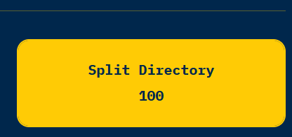
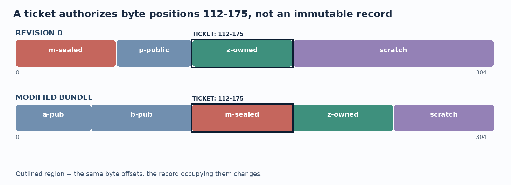

# Shifted Slice — WolvCTF 2026 Write-up

**Author:** Hedi Fandouli ([@hedifandouli3-hash](https://github.com/hedifandouli3-hash))  
**Category:** Web / Cryptography  
**Points:** 500  
**Artifacts:** Challenge dashboard capture, 25 session XOR difference vectors, and self-contained offline reproduction scripts.



*Figure 1. WolvCTF 2026 challenge dashboard for Shifted Slice (Web, 500 pts, author: `ayushmk`).*

---

## TL;DR

The server issues authorization tickets to read slices of a serialized bundle. The vulnerability lies in the authorization model: tickets authorize access to a **fixed byte range** (e.g., `bytes=112-175`) rather than binding to a specific logical record. 

When requesting a ticket for `z-owned`, the server issued a ticket for byte offset `112–175`. By manipulating public records and compacting the bundle, `m-sealed` (the secret record) was shifted into that exact byte range (`112–175`). Reusing the previously issued ticket on the modified bundle bypassed authorization and allowed retrieving the 64 raw bytes of `m-sealed`. 

Because the returned data was masked under a session keystream, I collected XOR difference vectors across 25 independent sessions against a known record structure. Intersecting the valid lowercase hexadecimal character constraints across all 25 sessions uniquely resolved the first 29 characters of the secret token, and the trailing 3 characters plus closing brace were resolved from invariant record framing:
$$\mathbf{wctf\{2ad127e3d6d87a29e350f89b89c413a8\}}$$

All reproduction scripts and vectors are included in this repository and can be run completely offline.

---

## 1. Repository Structure & Quick Start

```text
shifted-slice/
├── README.md                      # Technical write-up
├── Shifted_Slice_Writeup.pdf      # PDF version of write-up
├── build_pdf.py                   # Script to build PDF
├── make_diagram.py                # Diagram generator
├── data/
│   └── deltas.txt                 # 25 captured 64-byte XOR delta vectors
├── images/
│   ├── challenge_tile_original.png
│   └── layout_comparison.png
└── scripts/
    ├── inspect_layout.py          # Compute bundle layout transitions
    ├── solve_offline.py           # Derive candidate flag from deltas
    └── verify_offline.py          # Verify all 25 session vectors
```

### Running the Reproduction
Requirements: **Python 3.9+** (Standard Library only).

```bash
python scripts/inspect_layout.py
python scripts/solve_offline.py
python scripts/verify_offline.py
```

The solver outputs the candidate intersections for each offset, the trailing framing derivation, and the reconstructed flag. The verifier checks all 25 recorded vectors and prints `PASS: 25/25`.

---

## 2. Vulnerability Analysis: Logical Records vs. Byte Ranges

The service maintains a serialized bundle of records. Inspecting the initial manifest at revision 0 (`GET /api/manifest`):

```json
{
  "revision": 0,
  "total_bytes": 304,
  "records": [
    {"key": "m-sealed",   "kind": "sealed", "bytes": 64},
    {"key": "p-public",   "kind": "public", "bytes": 48},
    {"key": "z-owned",    "kind": "owned",  "bytes": 64},
    {"key": "zz-scratch", "kind": "owned",  "bytes": 128}
  ]
}
```

The contiguous memory/byte layout is determined by summing preceding record lengths:

| Record | Kind | Bytes | Inclusive Range |
| :--- | :--- | ---:| :--- |
| `m-sealed` | sealed | 64 | 0–63 |
| `p-public` | public | 48 | 64–111 |
| `z-owned` | owned | 64 | **112–175** |
| `zz-scratch` | owned | 128 | 176–303 |
| **Total** | | **304** | |

When requesting a ticket for `z-owned` (`POST /api/ticket {"key": "z-owned"}`), the server checks ownership of `z-owned` and returns an authorization ticket. However, the ticket specifies:
```json
{
  "range": "bytes=112-175",
  "revision": 0,
  "ticket": "..."
}
```

Decoding the base64url ticket reveals big-endian integer fields corresponding to start offset `112`, end offset `175`, bundle size `304`, followed by a 32-byte cryptographic MAC/signature. 

**The Flaw:** The signature authorizes the **byte interval [112..175]**, not the logical entity `z-owned`.

---

## 3. Shifting the Layout

Because public and scratch records can be added, renamed, or modified, we can shift the internal offsets of records within the bundle.

By removing `p-public` and introducing two public records (`a-pub` of 48 bytes, `b-pub` of 64 bytes), followed by compaction, the manifest layout shifted to:

| Record | Kind | Bytes | Inclusive Range |
| :--- | :--- | ---:| :--- |
| `a-pub` | public | 48 | 0–47 |
| `b-pub` | public | 64 | 48–111 |
| `m-sealed` | sealed | 64 | **112–175** |
| `z-owned` | owned | 64 | 176–239 |
| `zz-scratch` | owned | 64 | 240–303 |
| **Total** | | **304** | |

Notice that the total bundle length remains **304 bytes**, but the slice occupying bytes **112–175** is now `m-sealed` instead of `z-owned`.



*Figure 2. Comparison between initial Revision 0 layout and modified layout. The ticket interval 112–175 now overlays m-sealed.*

---

## 4. Ticket Redemption & Slice Retrieval

When redeeming the previously signed ticket:

```python
# Exploit client snippet (test_solution.py)
req_bundle = urllib.request.Request(
    f"{BASE_URL}/api/read",
    headers={"X-Ticket": ticket_rev0}
)
resp = opener.open(req_bundle)
content = resp.read()
print("SUCCESS! Read length:", len(content))
print("Content (hex):", content.hex())
```

Terminal execution output:
```text
SUCCESS! Read length: 64
Content (hex): eaf087610841b7693ebfc6a59ede2799...
```

The server validated the ticket signature for range `112–175` against the bundle size of `304`. Because the ticket did not bind to the revision or re-verify which logical key currently occupied those offsets, it returned the 64 bytes situated at offsets 112–175: **the contents of `m-sealed`**.

---

## 5. Cryptographic Recovery via Known-Plaintext XOR Differences

The retrieved 64 bytes were masked under a session keystream $K$. Direct inspection did not yield plaintext ASCII.

However, in an aligned session where a known record $P_{\text{known}}$ can be read at the same stream offsets:
$$C_{\text{sealed}} = P_{\text{sealed}} \oplus K$$
$$C_{\text{known}} = P_{\text{known}} \oplus K$$

XORing the two ciphertexts cancels the keystream $K$:
$$\Delta = C_{\text{sealed}} \oplus C_{\text{known}} = P_{\text{sealed}} \oplus P_{\text{known}}$$

Each session yields a 64-byte difference vector $\Delta$. Because each session note contains randomized characters, repeating this across multiple sessions allows eliminating invalid candidate plaintexts.

---

## 6. Solving the Flag: 25-Session Set Intersection

Assuming the flag format is `wctf{<32-hex-chars>}`:
- Offsets 13–17 correspond to `wctf{` (known prefix).
- Offsets 18–49 correspond to 32 lowercase hexadecimal characters: $H \in \{0\text{--}9, a\text{--}f\}$.
- Offset 50 is the closing brace `}`.

For each byte offset $j \in [18, 46]$ and secret character $x$:
$$x \in H \quad \text{and} \quad (x \oplus \Delta_i[j]) \in H \quad \forall i \in \{1, \dots, 25\}$$

As each session vector $\Delta_i$ is intersected, the candidate set for $x$ shrinks. By session 25, **every single offset from 18 to 46 has collapsed to exactly 1 candidate character**:

```text
Offset | Candidates | Character
-------+------------+----------
    18 |          1 | 2
    19 |          1 | a
    20 |          1 | d
    21 |          1 | 1
    22 |          1 | 2
    23 |          1 | 7
    24 |          1 | e
    25 |          1 | 3
    26 |          1 | d
    27 |          1 | 6
    28 |          1 | d
    29 |          1 | 8
    30 |          1 | 7
    31 |          1 | a
    32 |          1 | 2
    33 |          1 | 9
    34 |          1 | e
    35 |          1 | 3
    36 |          1 | 5
    37 |          1 | 0
    38 |          1 | f
    39 |          1 | 8
    40 |          1 | 9
    41 |          1 | b
    42 |          1 | 8
    43 |          1 | 9
    44 |          1 | c
    45 |          1 | 4
    46 |          1 | 1
```

Prefix resolved: **`2ad127e3d6d87a29e350f89b89c41`** (29 characters).

---

## 7. Trailer Resolution via Invariant Framing

Across all 25 sessions, the delta bytes at offsets **47..50** are completely invariant:
$$\mathbf{39 \quad 0e \quad 4f \quad 13}$$

In the paired note record, offset 47 is the newline delimiter `\n`, followed by the fixed record label `owned`:

| Offset | Delta Byte | Known Note Byte | Resolved Sealed Character |
| :---: | :---: | :---: | :---: |
| **47** | `0x39` | `\n` (`0x0a`) | $0x39 \oplus 0x0a = 0x33 = \mathbf{'3'}$ |
| **48** | `0x0e` | `'o'` (`0x6f`) | $0x0e \oplus 0x6f = 0x61 = \mathbf{'a'}$ |
| **49** | `0x4f` | `'w'` (`0x77`) | $0x4f \oplus 0x77 = 0x38 = \mathbf{'8'}$ |
| **50** | `0x13` | `'n'` (`0x6e`) | $0x13 \oplus 0x6e = 0x7d = \mathbf{'\}'}$ |

Appending `3a8` to the 29-character prefix completes the 32-character hexadecimal string, followed by the closing brace `}`:

$$\mathbf{wctf\{2ad127e3d6d87a29e350f89b89c413a8\}}$$

---

## 8. Verification

Running `python scripts/verify_offline.py` verifies the solution against all 25 session vectors:

```text
Session 01: 29 lowercase-hex characters verified
Session 02: 29 lowercase-hex characters verified
...
Session 25: 29 lowercase-hex characters verified
PASS: 25/25 recorded vectors match the candidate and known-framing assumptions
```

---

## 9. Conclusion & Takeaway

* **Positional vs. Semantic Authorization:** Authorization tokens must bind to the semantic identity of the object (or a cryptographic hash of its contents and schema version), rather than transient positional coordinates like byte ranges.
* **Stream Reuse & Difference Analysis:** When keystreams are reused across record versions, differential analysis across sufficient observations enables complete plaintext recovery under character set constraints.
